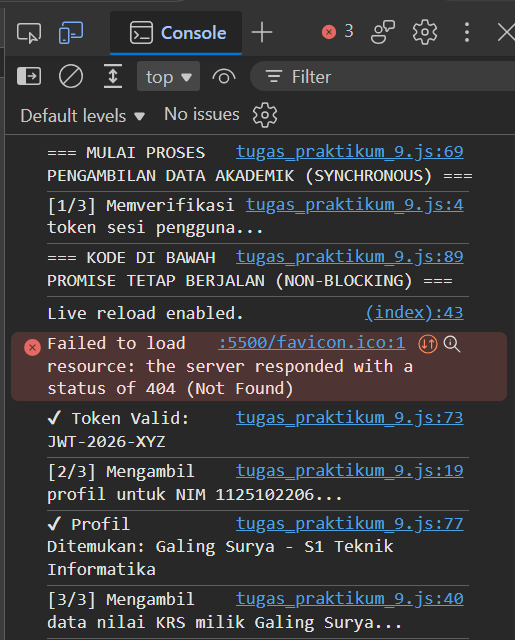
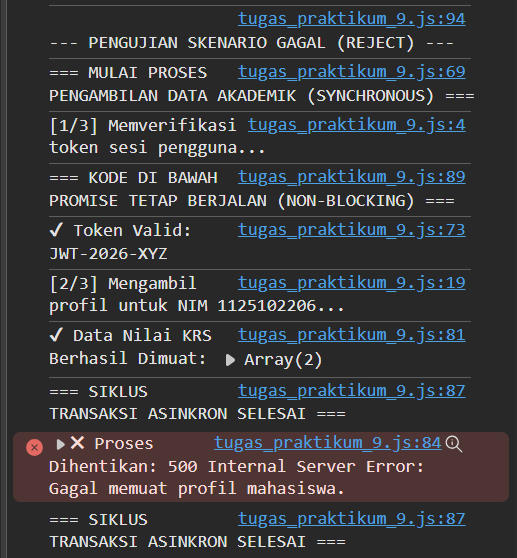

## Praktikum 9: Asynchronous JavaScript, Event Loop, dan Promise

* **Nama**: Galing Surya Nuralif Alamsya
* **NIM**: 1125102206
---
## Struktur Proyek
```text
praktikum-9-async-js/
├── index.html                      --> Halaman antarmuka untuk menjalankan & menguji skrip di browser
├── assets/
│   ├── image/
│   │   ├── Proses_sukses.png       --> Bukti tangkapan layar skenario sukses (Resolve)
│   │   └── Proses_gagal.png        --> Bukti tangkapan layar skenario gagal (Reject)
│   └── js/
│       ├── async_demo.js           --> Kode latihan simulasi latensi jaringan (materi pertemuan)
│       └── tugas_praktikum_9.js    --> Kode tugas utama (Promise Chaining 3 tahap & Error Handling)
└── README.md                       --> Dokumentasi analisis & bukti screenshot hasil console
```

### Analisis Mekanisme Non-Blocking, Call Stack, dan Event Loop

1. Bukti eksekusi Non-Blocking
Dari hasil pengujian di tab Console Browser, bisa di lihat bahwa javascript tidak menunggu proses yang lama untuk lanjut mengeksekusi bari kode di bawahnya:

    1. Saat skrip dijalankan, log sinkron pertama (=== MULAI PROSES PENGAMBILAN DATA AKADEMIK (SYNCHRONOUS) ===) langsung muncul di awal.
    2. Setelah itu, tahap pertama ([1/3] Memverifikasi token sesi pengguna...) langsung dipanggil.
    3. Hal yang membuktikan sifat non-blocking adalah baris === KODE DI BAWAH PROMISE TETAP BERJALAN (NON-BLOCKING) === langsung tercetak detik itu juga, tanpa menunggu proses setTimeout selama 1 detik di tahap pertama selesai.
    4. Setelah waktu tunggunya habis satu per satu (1000 ms 1200 ms 1000 ms), barulah hasil dari tiap tahapan .then() dan .finally() muncul secara berurutan di layar.

2. Peran Call Stack, Web APIs, dan Event Loop
Karena JavaScript pada dasarnya cuma punya satu jalur eksekusi (single-threaded), agar browser tidak nge-freeze saat mengambil data dari server, runtime JavaScript membagi tugas ke beberapa komponen:

 - Call Stack: Tempat mengeksekusi kode yang sifatnya langsung (synchronous). Semua console.log utama di luar setTimeout langsung masuk dan dikerjakan di sini terlebih dahulu.
 - Web APIs: Ketika program bertemu setTimeout (simulasi request jaringan), tugas tersebut dilempar keluar dari Call Stack ke Web APIs milik browser agar dihitung mundur di latar belakang tanpa mengganggu utas utama.
 - Microtask Queue: Begitu timer selesai dan Promise memanggil resolve() atau reject(), fungsi callback dari .then(), .catch(), dan .finally() dimasukkan ke antrean prioritas tinggi bernama Microtask Queue.
 - Event Loop: Bertugas sebagai pengawas lalu lintas. Event Loop terus mengecek apakah Call Stack sudah kosong. Begitu seluruh kode sinkron selesai dijalankan dan Call Stack kosong, Event Loop langsung mengambil tugas dari Microtask Queue untuk dieksekusi satu per satu.

3. Alur Promise Chaining & Error Handling Terpusat

 - Menghindari Callback Hell: Ketiga fungsi asinkron (verifikasiToken, ambilProfilMahasiswa, dan ambilNilaiKRS) disambungkan secara berurutan ke bawah menggunakan return di dalam blok .then(). Cara ini bikin kode jauh lebih rapi dan gampang dibaca dibanding pakai callback bersarang
 - Skenario Sukses (Resolve): Ketika semua kondisi bernilai true, data token dan NIM dari tahap 1 berhasil dikirim ke tahap 2 untuk mencari profil mahasiswa, lalu diteruskan lagi ke tahap 3 untuk menampilkan data nilai KRS.
 - Skenario Gagal di Tengah (Reject): Pada pengujian kedua (serverProfilAktif = false), proses berhenti di tahap 2. Tahap 3 (ambil nilai KRS) otomatis dilewati, dan alur program langsung melompat ke blok .catch() untuk menampilkan pesan error 500 Internal Server Error secara terpusat. Di akhir, blok .finally() tetap dijalankan baik saat skenario sukses maupun gagal.

### Bukti Tangkapan Layar Konsol (Console Output)



